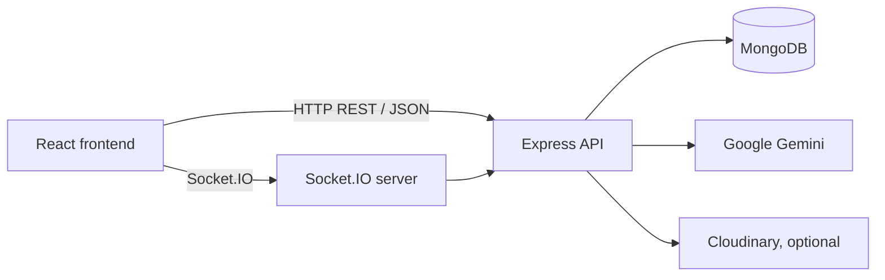
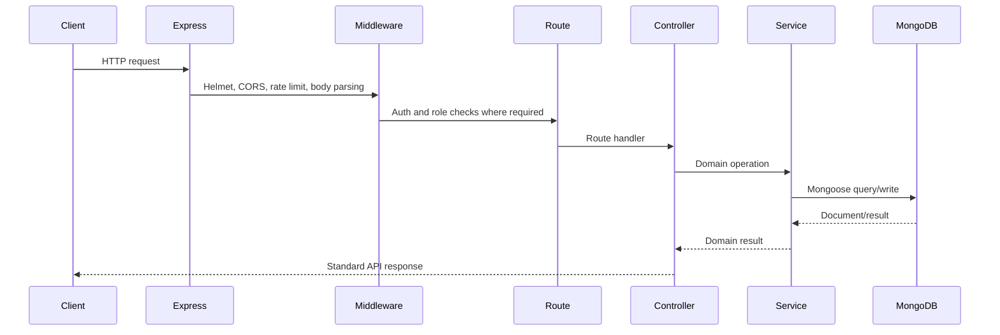
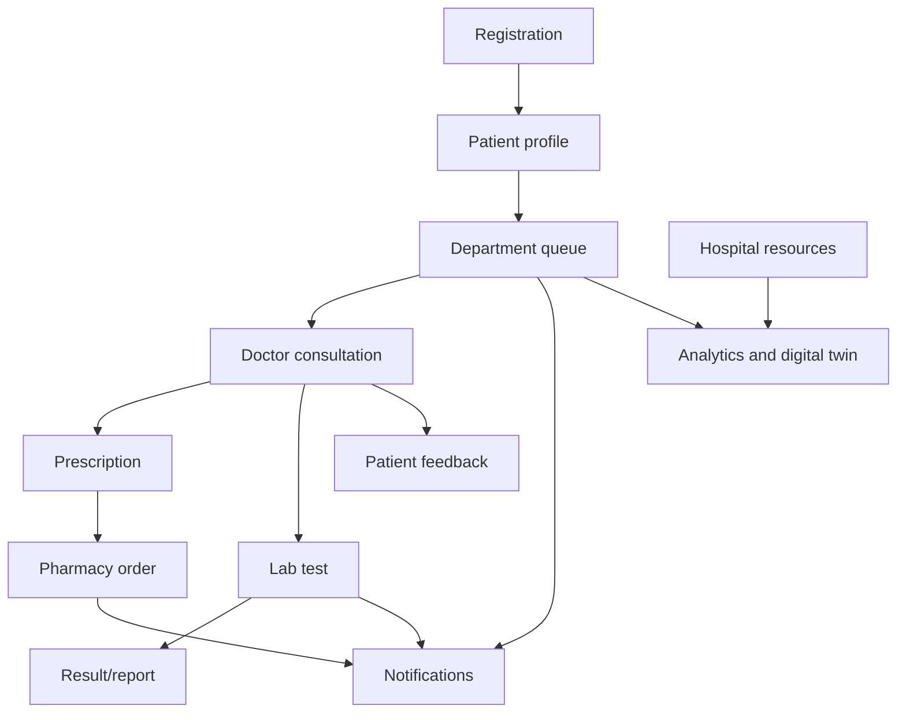

# CAREFLOW Architecture

## System context

CAREFLOW (QFlip) is a two-part web application:



The frontend is served by Vite during development and communicates with the backend through the configured API base URL. The backend creates one HTTP server, attaches Express to it, and initializes Socket.IO on the same server.

## Repository boundaries

```text
QFlip/
├── src/                         React + TypeScript frontend
│   ├── components/              Shared UI
│   ├── context/                 Auth, queue, and notifications
│   ├── layouts/                 Public, patient, and dashboard shells
│   ├── pages/                   Role-specific screens
│   └── routes/                  Route definitions and guards
├── backend/
│   ├── src/
│   │   ├── config/              Environment, database, logger, Cloudinary
│   │   ├── controllers/         Request handlers
│   │   ├── middleware/          Security, auth, validation, errors, uploads
│   │   ├── models/              Mongoose schemas
│   │   ├── routes/              REST route modules
│   │   ├── services/            Business and integration logic
│   │   ├── sockets/             Socket.IO setup
│   │   ├── utils/               Shared API and ID helpers
│   │   └── validators/           Request validators
│   └── tests/                   Backend integration tests
└── stitch_*/                    Design/reference HTML assets
```

## Backend runtime

Startup proceeds in this order:

1. Load environment configuration from `backend/.env`.
2. Connect to MongoDB.
3. In development or test mode, attempt an in-memory MongoDB fallback if the configured connection fails.
4. Create an HTTP server around the Express application.
5. Attach Socket.IO and register notification service access to the Socket.IO instance.
6. Listen on the configured port, defaulting to `8000`.
7. On `SIGINT` or `SIGTERM`, stop accepting requests and disconnect from MongoDB.

The main API base path is `/api`. Routes are grouped by domain:

| Prefix | Responsibility |
| --- | --- |
| `/api/auth` | Registration, login, and current-user access |
| `/api/patients` | Patient profiles and patient workflows |
| `/api/doctors` | Doctor profiles and doctor workflows |
| `/api/staff` | Staff operations |
| `/api/admin` | Administration and audit operations |
| `/api/departments` | Department configuration |
| `/api/queues` | Queue creation, status, and dispatch |
| `/api/appointments` | Appointment lifecycle |
| `/api/consultations` | Clinical consultation records |
| `/api/prescriptions` | Prescriptions and medication workflows |
| `/api/laboratory` | Lab requests and reports |
| `/api/pharmacy` | Pharmacy orders and dispensing |
| `/api/notifications` | User notifications |
| `/api/feedback` | Patient feedback |
| `/api/analytics` | Operational reporting |
| `/api/ai` | Triage and prediction features |
| `/api/resources` | Hospital resource management |

## Request pipeline



Errors are passed to the central not-found and error middleware. Shared `ApiError`, `ApiResponse`, and `asyncHandler` utilities should be used instead of implementing parallel response/error conventions.

## Real-time communication

Socket.IO runs on the backend HTTP server. Clients can join:

- `dept:<departmentId>` for live department queue updates.
- `user:<userId>` for private patient or staff notifications.

The client emits `join_department`, `leave_department`, and `join_user`. Backend services use the configured Socket.IO instance to publish queue, triage, prescription, and laboratory notifications.

## Security boundaries

- Passwords are hashed by the `User` model with bcryptjs and are excluded from normal queries.
- JWTs authenticate protected API requests.
- Role middleware restricts domain operations to permitted roles.
- Helmet, CORS, rate limiting, request validation, and centralized errors are applied at the API boundary.
- Uploads and generated report URLs must be treated as protected medical data.
- Secrets belong in environment variables; do not commit `.env` files or fallback secrets to production.

## Data and integration flow



## Operational notes

- The frontend and backend can be started independently or with `npm run dev:all`.
- MongoDB may be local or hosted through MongoDB Atlas.
- Gemini and Cloudinary integrations are optional at startup but required for their respective features.
- API details, payloads, response shapes, and event documentation are maintained in [`backend/API_DOCUMENTATION.md`](backend/API_DOCUMENTATION.md).

