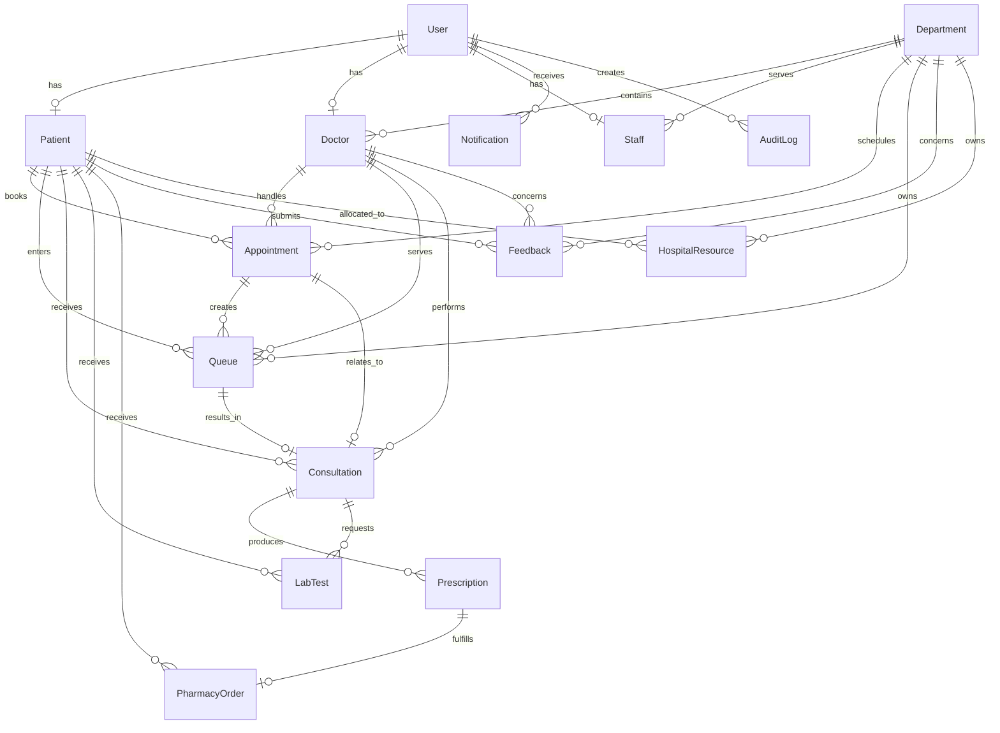

# CAREFLOW Database

## Database technology

CAREFLOW uses MongoDB through Mongoose. The default local database is:

```text
mongodb://localhost:27017/careflow
```

Set `MONGODB_URI` in `backend/.env` to use another local or Atlas database. Mongoose timestamps add `createdAt` and `updatedAt` to every model documented below.

In development and test environments, the backend can fall back to `mongodb-memory-server` when the configured MongoDB connection is unavailable.

## Entity relationship overview

MongoDB stores references with `ObjectId` values. Relationships are logical references resolved by Mongoose `ref`; MongoDB does not enforce foreign keys.



## Collections and important fields

### `users`

Defined by `backend/src/models/User.js`.

- Identity: `name`, unique lowercase `email`, `phone`.
- Authentication: hashed `password`, `isActive`, `isVerified`, `lastLogin`.
- Authorization: `role` is one of `patient`, `doctor`, `registration_staff`, `admin`, `lab_staff`, or `pharmacy_staff`.
- Passwords are hidden by default with `select: false` and hashed before saving.

### `patients`

Defined by `backend/src/models/Patient.js`.

- `patientId`: unique public patient identifier.
- `userId`: required reference to `users`.
- Demographics: date of birth, age, gender, and address.
- Emergency contact details.
- `basicMedicalInformation`: blood group, allergies, chronic conditions, and current medications.
- `registrationDate`: defaults to the current date.

### `doctors`

Defined by `backend/src/models/Doctor.js`.

- `doctorId`: unique public doctor identifier.
- `userId`: required reference to `users`.
- `departmentId`: required reference to `departments`.
- Specialization, qualification, room, OPD shift, availability, capacity, fee, and average consultation time.

### `staff`

Defined by `backend/src/models/Staff.js`.

- `staffId`: unique public staff identifier.
- `userId`: required reference to `users`.
- Optional `departmentId`.
- Designation, counter, shift, and active status.

### `departments`

Defined by `backend/src/models/Department.js`.

- Unique `name` and uppercase `code`.
- Description, floor, room numbers, average wait time, daily capacity, and active status.

### `appointments`

Defined by `backend/src/models/Appointment.js`.

- `appointmentNumber`: unique indexed identifier.
- References `patientId`, `doctorId`, and `departmentId`.
- Appointment date and time slot.
- Status: `scheduled`, `checked_in`, `completed`, `cancelled`, or `no_show`.
- Symptoms, priority (`normal`, `urgent`, `emergency`), and notes.

### `queues`

Defined by `backend/src/models/Queue.js`.

- Token identity: `tokenNumber` and numeric `sequenceNumber`.
- Required `patientId` and `departmentId`; optional doctor and appointment references.
- Status: `waiting`, `called`, `in_consultation`, `completed`, `skipped`, `transferred`, or `cancelled`.
- Triage level: `green`, `yellow`, or `red`.
- Priority score, symptoms, estimated wait, and lifecycle timestamps.
- Optional delay reason.

Indexes:

- `{ departmentId: 1, status: 1, sequenceNumber: 1 }` for live department ordering.
- `{ doctorId: 1, status: 1 }` for doctor queue views.
- `{ createdAt: -1 }` for recent queue records.
- `tokenNumber` and status are individually indexed.

### `consultations`

Defined by `backend/src/models/Consultation.js`.

- `consultationId`: unique indexed identifier.
- Required patient, doctor, department, chief complaints, and diagnosis.
- Optional queue and appointment references.
- Clinical observations, vital signs, clinical notes, follow-up date, and status.
- Status: `in_progress`, `completed`, or `referred`.

### `prescriptions`

Defined by `backend/src/models/Prescription.js`.

- `prescriptionNumber`: unique indexed identifier.
- Required consultation, patient, and doctor references.
- Embedded medication items with name, dosage, frequency, duration, instructions, and dispensing state.
- Dietary advice.
- Status: `pending_pharmacy`, `partially_dispensed`, `dispensed`, or `cancelled`.

### `labtests`

Defined by `backend/src/models/LabTest.js`.

- `testRequestId`: unique indexed identifier.
- Required patient and doctor references; optional consultation and lab staff references.
- Category, test name, priority, and status.
- Status: `requested`, `sample_collected`, `in_progress`, `completed`, or `cancelled`.
- Result summary, embedded result parameters, report URL, and completion timestamps.

### `pharmacyorders`

Defined by `backend/src/models/PharmacyOrder.js`.

- `orderNumber`: unique indexed identifier.
- Required prescription and patient references; optional pharmacist reference.
- Embedded medicine items with quantity, batch, price, and total.
- Total amount and payment status (`exempt_gov`, `paid`, or `pending`).
- Status: `received`, `processing`, `dispensed`, or `cancelled`.

### `notifications`

Defined by `backend/src/models/Notification.js`.

- Required recipient user reference, title, and message.
- Type: `queue_update`, `appointment_reminder`, `lab_ready`, `prescription_ready`, `system_alert`, or `triage_alert`.
- Read state and optional metadata for token, queue, department, and urgency.
- `recipientUserId` is indexed for user notification queries.

### `feedbacks`

Defined by `backend/src/models/Feedback.js`.

- Optional patient, department, and doctor references.
- Required rating from 1 to 5.
- Category: `doctor_care`, `wait_time`, `staff_behavior`, `cleanliness`, or `overall`.
- Comments, sentiment score/label, and anonymous flag.

### `hospitalresources`

Defined by `backend/src/models/HospitalResource.js`.

- Resource type: bed, ICU bed, ventilator, oxygen cylinder, wheelchair, or triage bay.
- Resource name and unique identifier.
- Optional department and allocated patient references.
- Ward, status (`available`, `occupied`, `maintenance`, or `reserved`), and maintenance timestamp.
- Status is indexed for availability queries.

### `auditlogs`

Defined by `backend/src/models/AuditLog.js`.

- Optional user reference and user role.
- Required action and resource, with optional resource identifier.
- IP address, user agent, and mixed-type details payload.
- Descending `createdAt` index for recent audit activity.

## Consistency and lifecycle rules

- Application code is responsible for preserving referenced-document consistency; deleting a referenced document does not automatically cascade.
- Queue status and timestamps represent the patient-flow lifecycle from check-in through completion, transfer, cancellation, or skip.
- Consultation records are the clinical parent for prescriptions and laboratory requests.
- A prescription can produce a pharmacy order; a lab test can later receive results and a report URL.
- Embedded medication and result-parameter arrays are intentionally stored within their parent documents because they are read and updated with the parent workflow.
- Medical records, uploaded reports, and audit details should be access-controlled and must not contain credentials or secrets.

## Seeding and testing

Seed development records from the repository root:

```bash
npm run seed
```

Run backend tests:

```bash
npm run test:backend
```

The test environment may use the in-memory MongoDB fallback. Use representative test data and clean up database state between tests when adding new integration coverage.

## Schema change guidance

When changing a model:

1. Update the Mongoose schema and any affected controllers/services.
2. Update request validation and API documentation for public field changes.
3. Check all `ref` names and populate paths.
4. Add or update focused backend tests.
5. Review indexes for the query patterns introduced by the change.
6. Never commit production credentials or real patient data.
